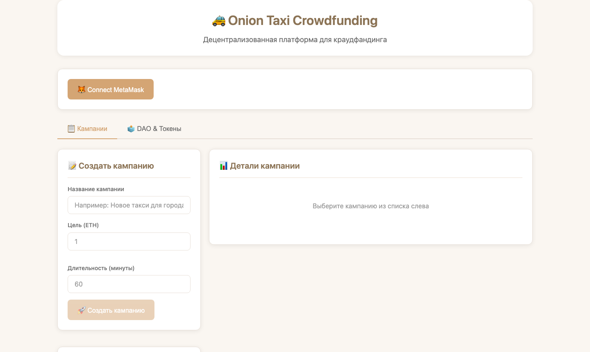
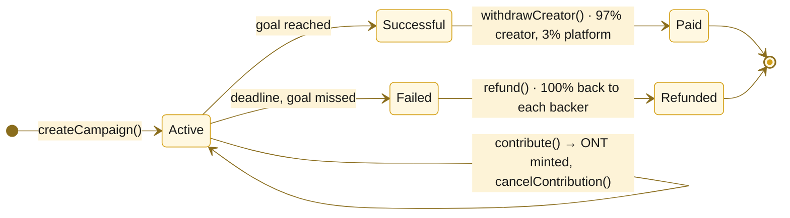
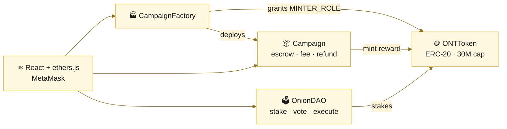

<div align="center">


# Onion Taxi: crowdfunding where the money waits in a contract

**Start a campaign, collect ETH in escrow, reward every backer with ONT tokens. If the goal is missed, everyone gets their ETH back. Holders stake ONT to vote in the DAO.**

<p align="center">
  
  
  
  
  
  
</p>



</div>

---

## 🚕 What it is

A decentralized crowdfunding dApp built as a blockchain course final project. Nobody holds the money in between:
each campaign is its own contract, the ETH sits there until the deadline, and the rules for payout, fee and refund
are code, not promises.

| | |
| --- | --- |
| **Campaigns** | Anyone creates one with a title, a goal in ETH and a duration |
| **Backers** | Contribute ETH, get ONT tokens at once, can cancel before the deadline |
| **Success** | Goal reached: the creator withdraws, 3% goes to the platform |
| **Failure** | Goal missed: every backer claims a 100% refund |
| **Governance** | ONT holders stake tokens and vote on proposals |

## ✨ Features

- **🏭 Campaign factory**: one transaction deploys a new `Campaign` contract and lets it mint rewards.
- **🪙 ONT rewards**: 100,000 ONT per 1 ETH contributed, minted to the backer in the same transaction.
- **🧢 Capped supply**: 30M ONT maximum, 20% minted to the treasury at deploy. When the cap is near, the last backer gets the remaining tokens instead of a failed transaction.
- **🔒 Escrow with exits**: cancel your contribution while the campaign runs, or claim a refund after it fails.
- **✅ Auto-finalize**: a campaign closes as soon as the goal is hit, or on the first withdraw or refund after the deadline.
- **🗳️ DAO**: hold at least 100 ONT to stake, stake at least 50 ONT to vote; voting weight equals your stake.
- **🛡️ Safe by default**: OpenZeppelin `ERC20`, `AccessControl` and `ReentrancyGuard`, custom errors, events for every state change.

## 🔁 A campaign's life



## 🏗️ How it's built



| Contract | Role |
| --- | --- |
| `ONTToken` | ERC-20 "Onion Taxi Token" with a hard cap and `MINTER_ROLE` |
| `CampaignFactory` | Deploys campaigns, keeps the list, collects the 3% fee address |
| `Campaign` | One fundraiser: contributions, rewards, finalize, withdraw, refund |
| `OnionDAO` | Staking and yes/no proposals weighted by stake |

The frontend (`frontend/`) is React 18 on Vite with ethers.js 6: connect MetaMask, create and back campaigns,
see progress, withdraw or refund, and stake and vote on the DAO tab.

## ✅ Tests

`test/OnionTaxi.test.js` runs the whole flow on the Hardhat network: treasury mint and roles at deploy, campaign
creation, contributions with token rewards, several backers, goal reached with the 3% fee split, and refunds when
the goal is missed.

## 🛠️ Run it

You need Node.js 18+ and MetaMask.

```bash
npm install && (cd frontend && npm install)
npx hardhat compile
npx hardhat test                                       # contract tests

npx hardhat node                                       # terminal 1: local chain
npx hardhat run scripts/deploy.js --network localhost  # terminal 2: deploy
cd frontend && npm run dev                             # terminal 3: http://localhost:5173
```

After deploying, copy the printed addresses into `frontend/src/config.js` if they changed.

<details>
<summary><b>🦊 MetaMask on localhost</b></summary>

1. Add a network: RPC URL `http://127.0.0.1:8545/`, chain ID `31337`, currency `ETH`.
2. Import an account: copy a private key from the `npx hardhat node` output (Account #0 or #1).
   These are public Hardhat test keys; never send real funds to them.

</details>

## 👥 Team

- [@astmirzhan](https://github.com/astmirzhan)
- [@birxnm](https://github.com/birxnm)
- [@Bleuble](https://github.com/Bleuble)

<div align="center">

**Onion Taxi** · blockchain course final project · the goal is met, or the money goes home 🧅

</div>
